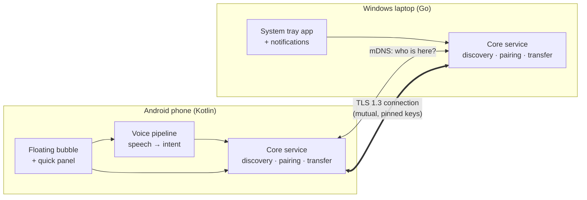
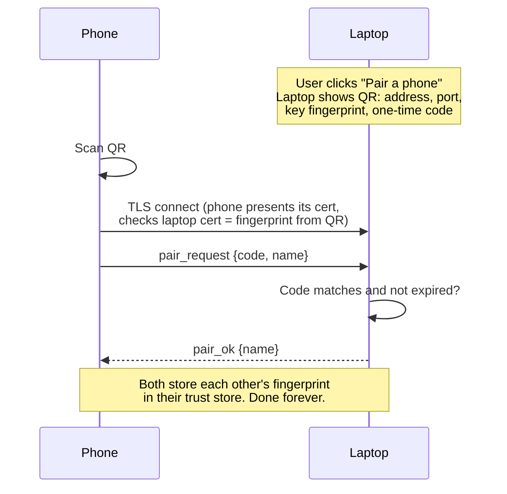
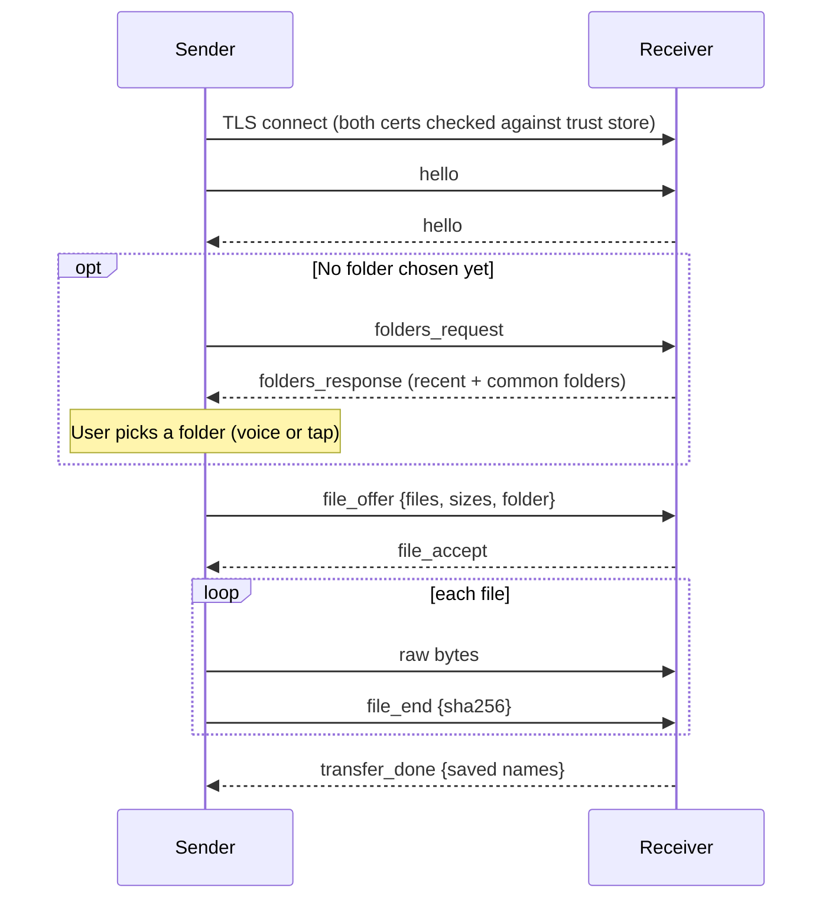

# Architecture

> Status: design for the MVP (phase 1). Read alongside the requirements doc.
> Written to be learned from: every decision lists the alternatives we rejected and why.

## 1. The big picture

Two small apps, one on each device, that find each other on the home Wi-Fi and talk
**directly** — no server, no cloud, no login.



Both apps contain the same **core**, written twice (Kotlin and Go) but following one
written contract: [`protocol/PROTOCOL.md`](../protocol/PROTOCOL.md). The UI parts
(bubble, voice, tray) sit on top of the core and never touch the network themselves.

**Why this split matters:** the core is the hard, reusable part. When we add remote file
search (phase 3) or an internet route (phase 4), only the core grows; the bubble and voice
pipeline just send new kinds of requests.

## 2. Components

| Component | Lives on | Job |
| --- | --- | --- |
| Identity | both | Creates the device's key pair + certificate once; stores it in the OS secure store |
| Trust store | both | List of paired devices: name, key fingerprint, last known address |
| Discovery | both | Announces this device via mDNS and listens for paired devices |
| Presence | both | Marks each paired device online/offline (mDNS + a ping every 5 s) |
| Connection | both | Opens/accepts mutual-TLS connections, rejects unknown keys |
| Protocol | both | Reads/writes framed messages (see PROTOCOL.md) |
| Transfer engine | both | Streams files, verifies checksums, writes `.part` then renames |
| Pairing UI | laptop shows QR, phone scans | One-time trust setup |
| Bubble + panel | phone | Overlay UI: devices, recent files, mic button |
| Voice pipeline | phone | Speech → text → intent → follow-up questions → action |
| Tray app | laptop | Status, pairing window, "received file" notifications, Explorer "Send to phone" |

## 3. Key flows

### 3.1 Pairing (once per device pair)



The QR is what makes this safe: it carries the laptop's key fingerprint, so the phone knows
it's talking to *your* laptop and not an impostor on the same Wi-Fi. The one-time code
proves to the laptop that the person holding the phone can see the laptop's screen.

### 3.2 Sending a file (every time)



### 3.2b Getting a file from the other device (fetch)

1. The requester browses the other device's shared folders (`list_request`; folders
   and files, newest first).
2. It sends `fetch_request` with the file names. The owner checks each one is a plain,
   visible file directly in that shared folder, then answers exactly like a sender:
   `file_offer`, bytes, `file_end`. The requester saves into its default folder.
3. Both sides reuse the same transfer code as sending (Go `internal/transfer`,
   Kotlin `Transfer.kt`), so checksums, `.part` files and cancel behave the same.

On Android, the standard folders (Downloads, Camera, …) are listed through MediaStore.
Photos, videos and music made by other apps need the media permission (a row in
Settings); other apps' documents stay hidden by Android, which is why "Add a folder"
exists for those.

### 3.2c The assistant (bubble + voice)

1. The bubble is an overlay window owned by the receiving service, so it lives as long
   as the phone is ready to receive. Tapping it opens `AssistantActivity`.
2. Speech: Android's recognizer, asking for the offline model first; if there is none
   for the language, it retries online (the hybrid). Typing works the same way.
3. Understanding: `Commands.parse` (rules, on the phone, unit-tested) turns a sentence
   into Send(what, device, folder) / Get(name, device) / Status.
4. "this" = the file last shared into LAN Share (10 min); otherwise it offers the latest
   photo, latest screenshot, or the file picker. Missing laptop or folder → a follow-up
   question, answered by voice or tap. Then a 2-second pause to cancel, then the same
   send/fetch code as the home screen.
5. An online AI model for free-form requests is planned; it needs an API key.

### 3.2d Phone ↔ phone

Phones pair with each other without a QR code: phone A shows a 6-digit code (2
minutes, one use, 5 wrong tries close it) and, only while it does, lets strangers
complete the TLS handshake, and then only to send `pair_request`. Phone B lists the
LAN Share phones it sees on mDNS (TXT `p=android`), the person picks A and types the
code. From then on they are ordinary paired devices: send, get, search, assistant.

### 3.3 Presence (online / offline)

1. Each app keeps announcing `_lanshare._tcp` on mDNS.
2. When a paired device's announcement appears, we record its current IP and port
   (home routers change IPs, so we never trust a saved IP for long).
3. Every 5 s we send `ping` over a short TLS connection to each paired device we know an
   address for. Reply → **online**. Two missed pings → **offline**.

## 4. Decisions and why

| Decision | Chosen | Rejected alternatives | Why |
| --- | --- | --- | --- |
| Topology | Direct device-to-device | Cloud server in the middle | Works offline, fastest path, nothing to host or pay for |
| Discovery | mDNS / DNS-SD | UDP broadcast, typing IPs | Standard; Android (NsdManager) and Go both support it; no config |
| Security | Mutual TLS 1.3, pinned self-signed certs | Password per transfer, custom encryption | Proven crypto, hardware-fast; per-transfer passwords add clicks, not safety. Never invent your own crypto |
| Framing | 4-byte length + JSON for control, raw bytes for file data | HTTP, gRPC, Protobuf | JSON is easy to read while learning and debugging; raw bytes keep big files fast. Can move to Protobuf later without changing the flows |
| One connection per action | Yes (MVP) | Long-lived connection | Simpler failure handling; TLS setup is ~10 ms on a LAN, invisible to the user |
| Port | TCP 47821 (falls back to a random port, advertised via mDNS) | Fixed port only | A fixed default helps debugging; mDNS tells the peer the real one |
| Received file names | `.part` while writing, rename after checksum OK; `name (2).ext` if taken | Overwrite | No half-written or silently replaced files |

## 5. Platform constraints we design around

- **Android "this file":** an app cannot see which file another app has open. We resolve
  "this file" from: a file shared into our app → the most recent file created → a picker.
- **Android background limits:** discovery and the receiving server run in a *foreground
  service* (shows a small persistent notification). Without it Android kills the server and
  the laptop could never send to the phone.
- **Android overlay:** the bubble needs the "Display over other apps" permission, granted
  once in settings.
- **Windows firewall:** the first run triggers a "Allow on private networks?" prompt; the
  user must allow it, or the phone can't connect. The tray app explains this.
- **Same-network check:** mDNS only works inside one network, so "device not found on
  mDNS" is our signal for "not on the same Wi-Fi" — the hook for the phase 4 internet route.

## 6. Repository layout

```
/android    Kotlin app: core service, bubble, voice
/windows    Go app: core service, tray
/protocol   PROTOCOL.md — the contract both apps implement
/docs       This file and other design notes
/.github    CI: builds the .exe and the APK on every push
```

## 7. Build order

1. **Spike (now next):** Windows core + Android core, pair by QR, send one file. No bubble, no voice.
2. Presence, folder choice, Share-menu integration, tray app.
3. Floating bubble and quick panel.
4. Voice pipeline: offline parser first, then the online model.
